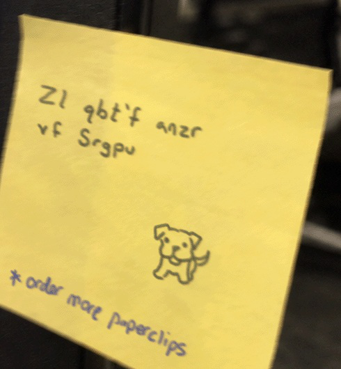

# Hail Caesar

> **Category:** Crypto · **Points:** 5 · **Track:** [Cryptography](README.md)

## Scenario

A faculty member at "Night Veil University" wrote a password hint on a sticky note stuck to their monitor. The note shows a doodle of a dog and a line of scrambled text. The challenge says the password is the dog's name, and asks for a submission as `deadface{dog's name}`.



*The sticky note photographed on the victim's monitor.*

## Step 1: Recognise the cipher

The note reads: `Zl qbt'f anzr vf Srgpu`. At first glance this looks like gibberish, but a few things give it away as a **Caesar cipher** (every letter shifted by a fixed amount through the alphabet):

- The text keeps the same word lengths and the same punctuation (the apostrophe in `qbt'f` lines up with where an apostrophe would be in English, like in "dog's").
- Letter patterns such as doubled letters are preserved in the same positions a normal English sentence would have them.

> **Beginner tip:** when short scrambled English-looking text shows up with normal spacing and punctuation intact, always try **ROT13** first (a Caesar shift of exactly 13). ROT13 is extremely common in puzzles because applying it twice gets back to the original text, which makes it a favourite "light obfuscation" trick.

## Step 2: Decode with ROT13

ROT13 shifts each letter 13 places forward in the alphabet (and wraps around from Z back to A):

```python
import codecs
s = "Zl qbt'f anzr vf Srgpu"
print(codecs.decode(s, 'rot13'))
```

```
My dog's name is Fetch
```

This can also be verified by hand, letter by letter: `Z→M`, `l→y`, `q→d`, `b→o`, `t→g` (spelling "My dog"), and so on. Every letter simply moves 13 positions through the alphabet.

## Step 3: Build the flag

The dog's name is **Fetch**. The challenge asked for the submission exactly in the format `deadface{dog's name}`.

## Flag

```
deadface{Fetch}
```

---
[← Back to index](../../README.md)
