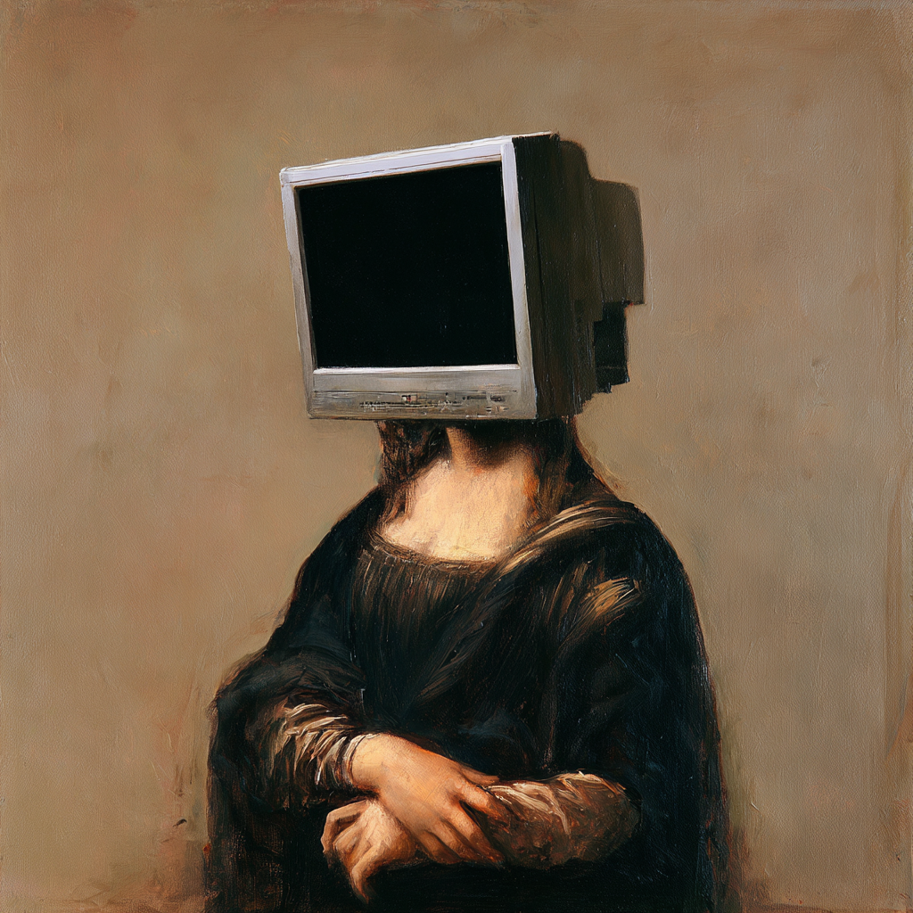

# Art Heist: The Forgery

> **Category:** Forensics · **Points:** 25 · **Author:** @syyntax · **Track:** [Forensics](README.md)

## The Scenario

The Turla Museum received back five paintings from its collection after a loan to another gallery. Investigators suspect DEADFACE secretly swapped one of the five original paintings for a forgery before they were scanned back into the museum's digital archive. The task: figure out which of the five image files is the fake, and recover the flag the forger left behind.

## Step 1: Download and verify the files

Every challenge file on DEADFACE CTF is provided with a SHA-256 checksum. Always verify it before analysing a file, this guarantees working with the exact bytes the challenge author published, with nothing corrupted or tampered with in transit.

```bash
$ unzip CTF_Forgery_Paintings.zip
$ sha256sum CTF_Forgery_Paintings.zip
f4d4d1185b94639bfbcfadb81abbea667977760dd31834dfc52d4d65a846cb12

$ ls
Painting_001.png Painting_002.png Painting_003.png
Painting_004.png Painting_005.png
```

## Step 2: Why metadata, and not the pixels

The challenge text hints that "the forger left behind traces of their work in the digital records", not in the picture itself. PNG files can carry hidden text chunks (called `tEXt`, `zTXt` and `iTXt`) used to store information such as the software that created the file, the author, comments, or even full XMP metadata blocks. A forger re-exporting an image with different software almost always leaves a different metadata fingerprint than the original files, even if the picture looks identical to the human eye.

## Step 3: Read every PNG chunk with a small Python script

PNG files are built from a sequence of "chunks": a 4-byte length, a 4-byte type (e.g. `IHDR`, `iTXt`, `IDAT`), the chunk data, and a checksum. A short script walks through every chunk of all five files and prints anything that is not raw pixel data (`IDAT`):

```python
import struct, glob

for f in sorted(glob.glob('Painting_*.png')):
    d = open(f, 'rb').read()
    p = 8
    print('==', f)
    while p < len(d):
        l, = struct.unpack('>I', d[p:p+4])
        t = d[p+4:p+8]
        body = d[p+8:p+8+l]
        if t != b'IDAT':
            print(' ', t, l, body[:600])
        p += 12 + l
        if t == b'IEND':
            break
```

## Step 4: Spot the odd one out

Four of the five images shared identical, consistent metadata: the same editing software ("Atelier Archive"), a single named artist, and the same file modification date (1 September). **Painting_002.png** was different in every one of these respects:

- Software tag: `LAMIA Restoration Utility 0.0.13` instead of `Atelier Archive`.
- An embedded comment reading *"checksum mismatch; palette recovered from cache"*, language that has nothing to do with restoring a painting.
- Creator field listing *"Leonardo da Vinci / LAMIA"* instead of a single real artist name.
- A status note: *"Authenticity status: pending. Restoration log incomplete."*
- A file modification date of **15 October**, two weeks after all the other files (1 September).



*Painting_002.png, the forged artwork, identified purely from its metadata.*

## Step 5: Extract the flag

Once the suspicious file was identified, printing its full XMP metadata block revealed a `dc:identifier` field containing the flag outright:

```bash
$ exiftool -XMP:Identifier Painting_002.png
```

## Flag

```
deadface{L4MIA_SIGNS_HER_WORK}
```

> **Lesson:** metadata tells a story the pixels never will. Always check it first.

---
[← Back to index](../../README.md)
