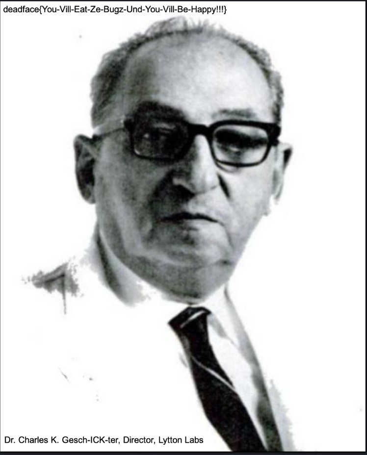

# Cereal Killer 01

> **Category:** Reverse Engineering · **Points:** 50 · **Author:** @TheZealot · **Track:** [Reverse Engineering](README.md)

## What We Were Given

A small Linux x86 (32-bit) ELF binary. The challenge story is themed around an alien "Insectoid" species whose favorite breakfast cereal needed to be discovered. The challenge asks to crack the password protecting the binary, enter it, and follow where it leads; the text printed by the binary is explicitly **not** the real flag, just a confirmation message. The password was already given as cracked: `cookiecrisp`. The task was to use that password to recover the actual flag.

## Step-by-Step Walkthrough

### 1. Identify the binary

The first thing to do with any unknown binary is to identify its type before trying to analyze it:

```bash
$ file re01-lin-x86.bin
re01-lin-x86.bin: ELF 32-bit LSB executable, Intel 80386 ...
```

### 2. Disassemble and look for interesting strings

Using `objdump -d -M intel`, the `main` function was disassembled. Rather than a simple plain-text password check (like `strcmp`), the binary stored two long, encoded blocks of text inside it. Dumping those bytes showed that each character was stored as two bytes (a 16-bit / "wide" character) instead of a normal one-byte ASCII character, a strong hint that the strings were deliberately encoded rather than just stored as plain text.

### 3. Find the custom alphabet

Searching the binary's data section further found a 64-character alphabet stored the same way (two bytes per character). This is the classic signature of a Base64 encoding scheme, except using a custom, scrambled alphabet instead of the standard one (`A-Z a-z 0-9 + /`). This alphabet was extracted directly from the binary, and a small Python decoder was written that works just like Base64, but looks up each character's value in this custom alphabet instead of the usual one.

```python
alpha = <64-character alphabet extracted from the binary>

def decode(s):
    values = [alpha.find(c) for c in s]
    # reassemble 3 bytes out of every 4 Base64 characters,
    # exactly like standard Base64 decoding
    ...
```

> **Beginner tip:** Base64 always expands data by roughly 4/3 and uses an alphabet of exactly 64 symbols (plus a padding character). Whenever a block of text in a binary is made only of printable characters, with a length always a multiple of 4, and a matching 64/65-character alphabet stored nearby, that is almost always a strong sign of a custom Base64 variant.

### 4. Decode the first string, a SHA1 hash

Running the custom decoder on the first encoded block produced a 40-character hexadecimal string: `68158678a3f9d76a3d1ca12d20b2d6af9bd3f290`. A 40-character hex string is exactly the length of a SHA1 hash. Testing this by computing the SHA1 of the known password:

```bash
$ python3 -c "import hashlib; print(hashlib.sha1(b'cookiecrisp').hexdigest())"
68158678a3f9d76a3d1ca12d20b2d6af9bd3f290
```

It matched exactly, confirming that this block is simply the password-check hash, and that `cookiecrisp` is genuinely the correct password for the binary.

### 5. Decode the second string, encrypted data

The second encoded block decoded (via the same custom Base64 scheme) into 59 raw bytes that did not look like readable text, a sign that it was further encrypted. Since the binary clearly uses the password as a secret value (it already used it to compute a SHA1 hash), the natural next guess was that the password also serves as the decryption key for this second block. The very common stream cipher RC4 was tried, using the password `cookiecrisp` directly as the RC4 key:

```python
def rc4(key, data):
    S = list(range(256))
    j = 0
    for i in range(256):
        j = (j + S[i] + key[i % len(key)]) % 256
        S[i], S[j] = S[j], S[i]
    i = j = 0
    out = bytearray()
    for b in data:
        i = (i + 1) % 256
        j = (j + S[i]) % 256
        S[i], S[j] = S[j], S[i]
        out.append(b ^ S[(S[i] + S[j]) % 256])
    return bytes(out)

print(rc4(b"cookiecrisp", ciphertext))
```

This produced a readable result, a URL:

```
https://cerealkiller.lyttonlabs.org/unwanted-guests/ick.png
```

### 6. Fetch the image and read the flag

Downloading that URL gave a PNG image. It was checked for hidden data first (EXIF metadata, trailing bytes after the PNG end marker, LSB steganography), and nothing was found, because the flag was simply printed directly on the image as visible text, at the top and bottom of a portrait photo of "Dr. Charles K. Gesch-ICK-ter, Director, Lytton Labs".



*The downloaded image "ick.png", with the flag printed directly at the top of the picture.*

| Step | Technique |
|---|---|
| Identify binary | `file` |
| Disassemble | `objdump -d -M intel` |
| Decode embedded strings | Custom Base64 alphabet extracted from the binary |
| Verify password | SHA1 hash comparison |
| Decrypt hidden payload | RC4 stream cipher, password used as key |
| Reveal the flag | Downloaded image contained the flag as plain visible text |

## Flag

```
deadface{You-Vill-Eat-Ze-Bugz-Und-You-Vill-Be-Happy!!!}
```

---
[← Back to index](../../README.md)
