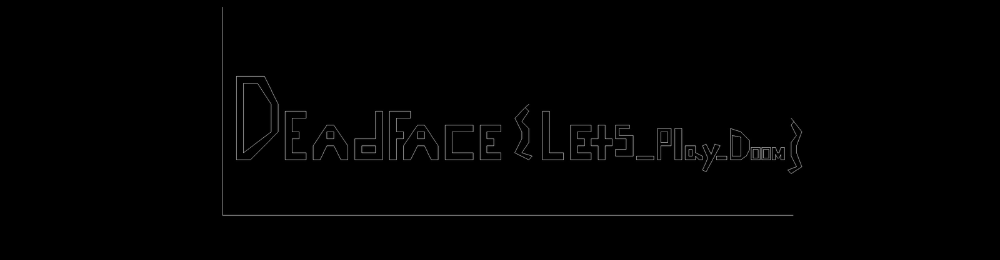

# DOOM (Bonus)

> **Category:** Bonus · **Points:** 25 · **Track:** [Reverse Engineering](README.md)

## Scenario

A light-hearted bonus challenge: download a custom level ("WAD" file) for the open-source Doom engine (GZDoom + the free `freedoom2.wad` asset pack), load it, play through it, and the flag is supposedly "obvious" once the end is reached.

## Step 1: A faster way than playing the whole level

Rather than installing GZDoom and walking through the level in real time, the challenge only provides a `MAP01.wad` file, a "PWAD" (Patch WAD) that stores the level geometry as plain, documented binary data. Doom levels are built from a 2D floor plan: a list of 2D points ("vertices") and the straight wall segments connecting them ("linedefs"). Reading those two lists directly from the file makes it possible to draw the level's floor plan without running the game at all.

> **Beginner tip:** classic Doom level files (`.wad`) use an openly documented, simple binary format from the 1990s. A "WAD" starts with a small header (how many data chunks, called "lumps", and where they are), followed by the lumps themselves: things like `VERTEXES` (a flat list of X/Y coordinate pairs) and `LINEDEFS` (pairs of vertex indexes describing which points are connected by a wall).

## Step 2: Extract the level geometry with Python

The WAD's lump directory was parsed, then the `VERTEXES` and `LINEDEFS` lumps were read directly as binary structures (`struct.unpack` in Python):

```python
import struct

data = open('MAP01.wad', 'rb').read()
numlumps, infotableofs = struct.unpack('<ii', data[4:12])

def get_lump(name):
    for i in range(numlumps):
        off = infotableofs + i * 16
        filepos, size, nm = struct.unpack('<ii8s', data[off:off + 16])
        if nm.rstrip(b'\x00').decode() == name:
            return data[filepos:filepos + size]

vertexes = get_lump('VERTEXES')
verts = [struct.unpack('<hh', vertexes[i*4:i*4+4])
         for i in range(len(vertexes) // 4)]

linedefs = get_lump('LINEDEFS')
lines = [struct.unpack('<HH', linedefs[i*14:i*14+4])
         for i in range(len(linedefs) // 14)]
```

## Step 3: Draw the floor plan as an image

With a list of 2D points and which pairs of points are connected by a wall, drawing a top-down map is simple: open an image, and for every linedef, draw a straight line between its two vertices (flipping the Y axis, since image coordinates grow downward while Doom's grow upward):

```python
from PIL import Image, ImageDraw

im = Image.new('RGB', (2000, 2000), 'black')
draw = ImageDraw.Draw(im)
for v1, v2 in lines:
    x1, y1 = verts[v1]
    x2, y2 = verts[v2]
    draw.line([x1, -y1, x2, -y2], fill='white')  # (simplified)
im.save('automap.png')
```

The resulting image revealed the level was never meant to be "played through" at all; its walls were laid out to literally **spell out text** when viewed from directly above, like a giant architectural sign only visible on the in-game automap or from outside the engine entirely:



*The level's wall geometry, rendered top-down straight from VERTEXES/LINEDEFS. The flag is spelled out directly in the map layout.*

## Step 4: Read it off

Zooming into the rendered floor plan, the walls clearly spell:

```
DeadFace{Lets_Play_Doom}
```

Converted to the lowercase `deadface{...}` format requested by the submission box:

## Flag

```
deadface{Lets_Play_Doom}
```

---
[← Back to index](../../README.md)
